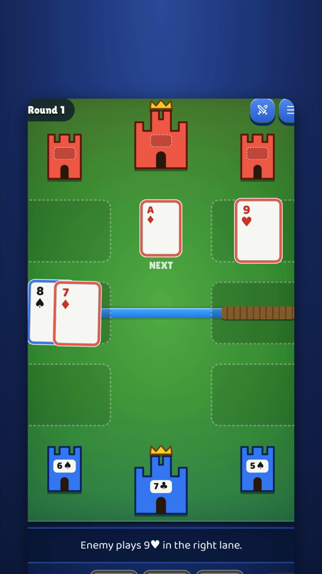
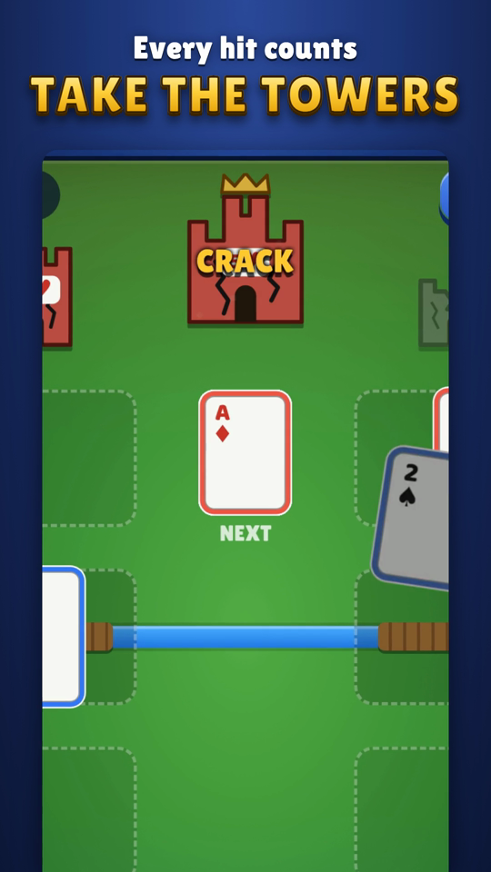
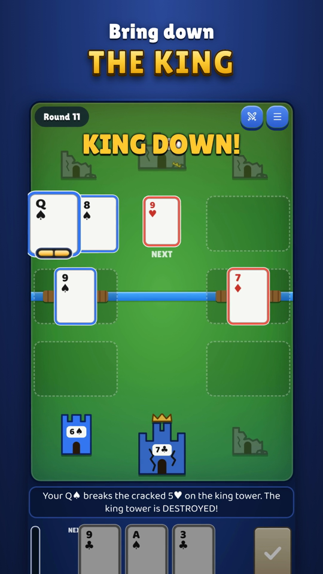
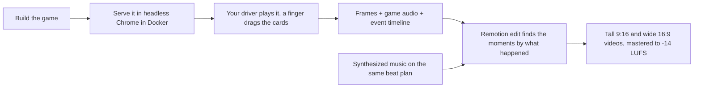
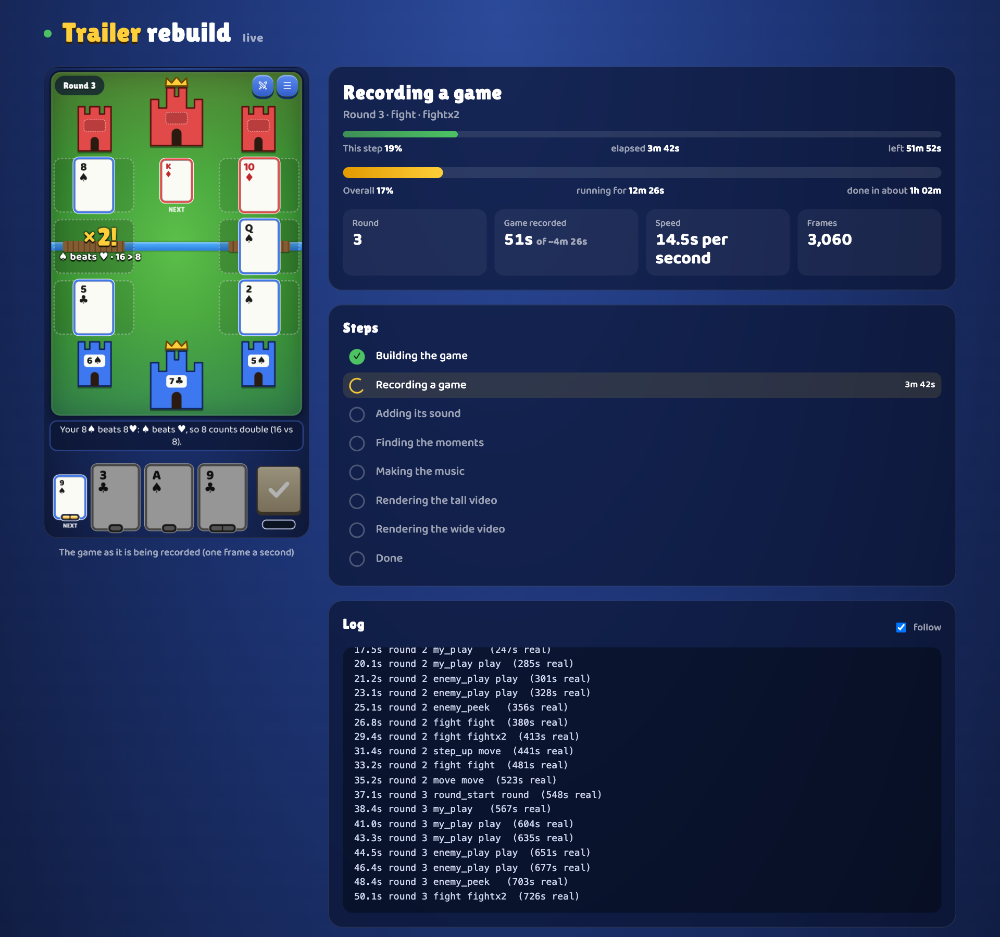

# trailer-kit: make a game trailer from the game playing itself

**trailer-kit is a free, open-source tool that turns a browser game into trailers with no screen recorder and no video editing.** A script plays your game by itself, the kit records it **frame by frame at 60 fps with the game's own sound in sync**, and a [Remotion](https://www.remotion.dev) edit cuts it into two ready-to-post videos: **9:16 for TikTok, Reels, Shorts and Reddit** and **16:9 for YouTube and itch.io**, with original music and loudness mastered to -14 LUFS.

It was built for [Suitkeep](https://github.com/IFAKA/suitkeep), a solo card game, and extracted so any web game can use it: the kit knows nothing about a game, which plugs in with a config, a driver and an edit.

<p align="center">
  
  
  
  
</p>

## How it works



### Why the recording is deterministic

The recording does not depend on how fast your computer is. This is what makes the footage smooth and the sound exact:

- **Virtual time.** Chrome runs in Linux (headless, driven by `puppeteer-capture`) and the kit takes over the page's clock. `Date.now`, `performance.now`, `requestAnimationFrame`, timers and CSS animations advance exactly 1/60 s per captured frame, however long the computer takes to draw it. A slow machine records slower, never choppier: on an M4 Pro a 3-minute game records in about 4 minutes, and the video is perfect on any machine.
- **Fast frames.** Each frame comes back from Chrome as a JPEG encoded for speed (quality 95), not the PNG `puppeteer-capture` asks for: compressing a 1080x1920 PNG was over 90% of the recording time (244 ms a frame against 19), which made a rebuild take about 50 minutes.
- **Sample-accurate sound.** The page's `AudioContext` is replaced by an offline one running on that same virtual clock, so every sound lands in the track at the exact frame it happened.
- **Moments found by events, not times.** The driver `mark()`s what happens ("ace beat a king", "tower cracked"). The edit looks those up in `out/timeline.json`, so a new recording lines up by itself after the game changes.
- **A deterministic edit.** Each Remotion frame is a pure function of its frame number, so the same recording and edit render the same video.

The one thing the kit cannot make deterministic is **the game's own logic**: a game with random deals or a random enemy plays differently on every run. Give the driver a fixed seed or a fixed deal (Suitkeep plays its fixed first-game deal) and the footage repeats.

## Live progress page

`trailer-kit rebuild` opens a page with the stage, time left, the game being recorded, and the log.

<p align="center">
  
</p>

## Commands

A game plugs in with a **config**, a **driver** and an **edit**, all living in the game's own repo (see below).

```
trailer-kit rebuild [project]   build the game, record it, make the music, render and master both trailers (about 6 minutes)
trailer-kit master  [project]   render and master again from the last recording (minutes)
trailer-kit record  [project]   record only
trailer-kit watch   [project]   the live progress page (http://localhost:4321; `rebuild` opens it)
trailer-kit studio  [project]   the edit in Remotion Studio
```

`[project]` is the folder with `trailer.config.json` (default: the current one). Needs Node, ffmpeg, Docker and Colima (the recording runs in
Linux, the only place Chrome renders frame by frame on demand; `rebuild` starts Colima if needed and stops it after).

## What a game provides

A folder (e.g. `mygame/trailer/`) with:

**`trailer.config.json`**
| key | |
|---|---|
| `name`, `url` | the game's name and web address; file names and video titles come from them |
| `build` | `{ "command", "dir" }`: command runs in the project folder, `dir` is the build output the kit serves. Or `"target": "http://..."` for a running page |
| `driver` | the driver module (default `driver.mjs`) |
| `mount` | folder, relative to the project, the container can see (default `.`); needs to reach the game's source if the driver reads it |
| `viewport`, `fps` | the phone screen in CSS pixels and its scale (default 432x768 at 2.5 = 1080x1920), frames per second (60) |
| `edit` | `{ "entry": "src/index.ts", "plan": "src/plan.ts" }`: the Remotion edit. It must register compositions **`Tall`** and **`Wide`**. `plan` is optional: exports `S` (sections, in beats) and `frames()` so the progress page can name the section being drawn |
| `music` | a command, run in the project folder, that writes `out/music.wav` |
| `afterRecord` | a command run after the recording (e.g. list the moments found) |

**`driver.mjs`** (the only code that touches the game)
```js
export async function setup({ page, url, config }) {}   // get the game to its starting screen
export async function play(ctx) {}                      // play until done
// ctx: page, recorder, wait(ms), now(), mark(type, data), drag(from, to), tap(selector), progress(patch), viewport, fps, env
```
`mark()` adds `{ t, type, ...data }` to `out/timeline.json`, which the edit reads to find its moments by what happened, not by time.
`drag` and `tap` move a visible finger (also on the timeline) the way a person would.

**the edit**: a Remotion project (`src/`) that reads `out/gameplay-av.mp4`, `out/timeline.json` and `out/music.wav` (the folder is Remotion's public dir).
The game's `package.json` needs `remotion`, `react`, `@remotion/cli` and `trailer-kit` (`"file:../path/to/trailer-kit"`); keep the Remotion versions equal to the kit's.

Outputs land in `<project>/out/`: `<slug>-trailer-tall.mp4`, `<slug>-trailer-wide.mp4`.

## Notes
- The game's sounds are captured through a replaced `AudioContext` (offline context on the page's virtual clock). A game that doesn't use Web Audio gets a silent recording.
- The container sees the kit and the `mount` folder at their own paths, so paths mean the same inside and out.

## License

MIT
